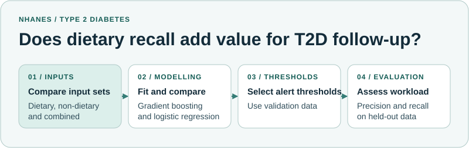

# Type 2 Diabetes Follow-Up Prioritisation

A study of how dietary recall and other non-laboratory information could help decide who to prioritise for follow-up.

*Workload-Aware Type 2 Diabetes Follow-Up Prioritisation Using Dietary Recall and Non-Laboratory Information: A Cross-Sectional Study*

| | |
| --- | --- |
| **Research question** | How many people would be flagged for follow-up at different decision thresholds, and how many diabetes cases would those thresholds identify? |
| **Data** | Dietary recalls and non-laboratory information from the US National Health and Nutrition Examination Survey (NHANES). |
| **Method** | Select thresholds on validation data and evaluate them on held-out data. Compare follow-up workload, precision and recall. Laboratory measurements help define the outcome. |

[Back to the research portfolio](https://github.com/Shahin-Ghanbari#featured-research)
